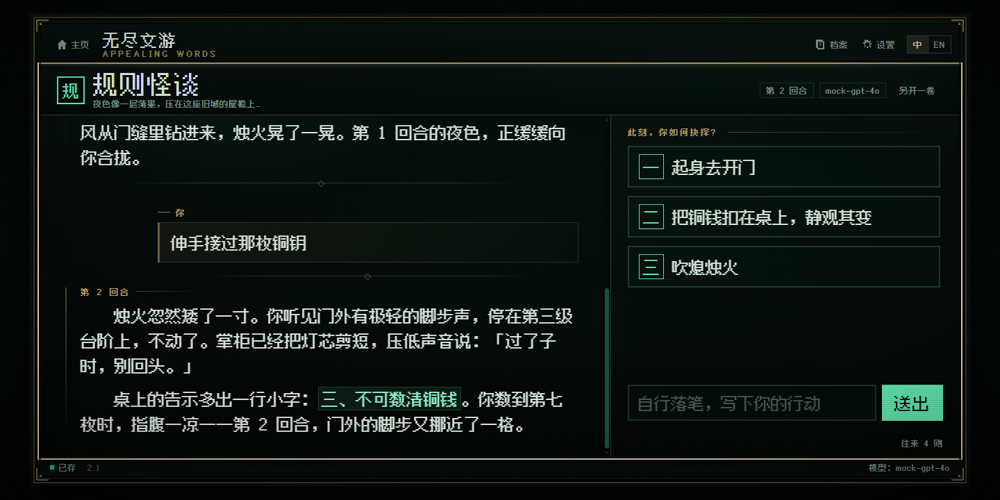
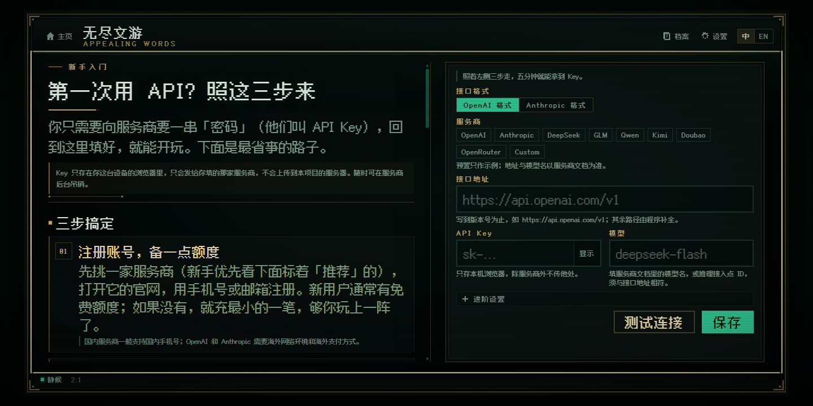
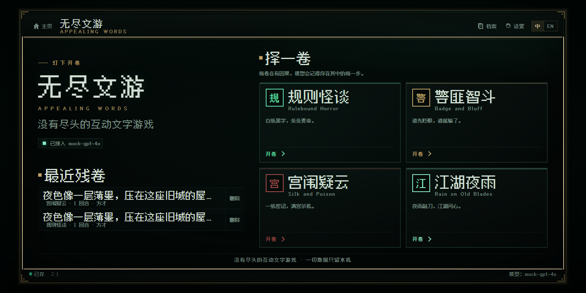
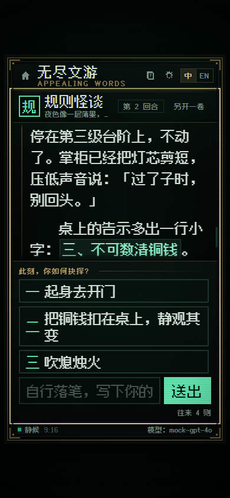

**English** · [中文](README.md)

# Appealing Words · 无尽文游

**An interactive text adventure that never ends.**

A bilingual (Chinese / English) text adventure powered by your own AI model. No sign-up, no login, no server: paste in your own API key, pick a volume, and keep playing.

**▶ Play online: [nolai2010.github.io/AppealingWords](https://nolai2010.github.io/AppealingWords/)**

[](LICENSE)
[](https://nolai2010.github.io/AppealingWords/)



---

## What is this

Appealing Words is a **story generator disguised as a game**. It turns your own AI model into a narrator: the model improvises within a genre's world, offers three or four choices, you pick one — and it writes on.

- Every playthrough is generated on the fly. No two are alike.
- There is no win condition. The story can go on as long as you like.
- Your API key, saves and settings live only in **your own browser**. They never pass through any server.
- It is a pure front-end project, hosted on GitHub Pages, fully open source.

Four volumes: Rulebound Horror, Badge and Bluff, Silk and Poison, and Rain on Old Blades — see "The four volumes" below.

## First time? Get an API key first

> This section is for people who have never touched an API. It takes about five minutes.

Appealing Words does not include a model and charges nothing. Every sentence is generated by your own AI account at a provider you choose, and billed to that account by usage. So the first time you open the page, you need to give the game a key.

### The three words that matter

| Term | In plain words | What it looks like |
| --- | --- | --- |
| **API Key** | The "password" your provider issues you. It proves the request is yours and lets the provider bill you by usage. Treat it like a bank PIN — keep it to yourself. | A long string, often starting with `sk-`; formats vary |
| **Base URL** | The provider's "mailing address" for requests. The game sends your story requests here. Usually you enter it up to a version path like `/v1`; the game appends the rest. | `https://api.deepseek.com` |
| **Model name** | The name of the "writer" you are hiring. Models differ in ability, speed and price; a wrong name means no writer shows up. | `deepseek-flash` |

> Can't remember the three words? On the setup screen, click the fill-in button on a provider card and the address and model name fill themselves in — you only paste the key.

### Three steps to your key

**Step 1: Sign up and add a little credit (or claim free credits)**
Open a provider's website and sign up with a phone number or email. In the console / billing section, top up a small amount, or claim any new-user credit. Most mainland-China providers accept common local payment methods (check each provider's site).

**Step 2: Create and copy a key in the console**
Find the "API Keys" / "Key management" section, click create, and copy the long string it shows. Some providers only show it once, so save it somewhere only you can see. **Never post a key in a chat, a screenshot, or a public repository.**

**Step 3: Come back, fill in three fields, and test**
On the setup screen (on mobile it sits below the guide), choose the API format, enter the Base URL, paste the API key and type the model name, then click "Test connection". When you see "connected", click "Save and start". You will not need to fill it in again; you can change it anytime under Settings → API. You can also click the fill-in button on a provider card to populate the address and model name in one go.



### Which provider should I pick?

If you are outside mainland China, the smoothest starting points are **OpenAI, Anthropic and OpenRouter** — accounts, billing and network access tend to line up. **DeepSeek, Kimi and Qwen** are excellent value and allow direct browser calls, but their sign-up and payment flows are built around the mainland-China market. Pick whichever you can actually sign up for and pay.

The table reflects what we observed in November 2026. Model names and API addresses change — **always trust the provider's documentation**.

| Provider | Good for beginners | Browser access | Billing | Get a key | Docs |
| --- | --- | --- | --- | --- | --- |
| DeepSeek | ◯ Great value; China-market account/payment | ✅ Direct (ok) | CNY | [Get a key](https://platform.deepseek.com/api_keys) | [Docs](https://api-docs.deepseek.com/) |
| Kimi (Moonshot) | ◯ China-market account/payment | ✅ Direct (ok) | CNY | [Get a key](https://platform.kimi.com/console/api-keys) | [Docs](https://platform.kimi.com/docs/api/overview) |
| Qwen (Alibaba Cloud Model Studio) | ◯ China-market account/payment | ✅ Direct (ok) | CNY | [Get a key](https://bailian.console.aliyun.com/) | [Docs](https://help.aliyun.com/zh/model-studio/) |
| OpenRouter | ✅ Recommended: one key, many models | ✅ Direct (ok) | Depends on model | [Get a key](https://openrouter.ai/keys) | [Docs](https://openrouter.ai/docs) |
| Zhipu GLM | ◯ Usable | ⚠️ Needs relay (relay; CORS-blocked in our tests) | CNY | [Get a key](https://bigmodel.cn/usercenter/proj-mgmt/apikeys) | [Docs](https://docs.bigmodel.cn/) |
| Doubao (Volcengine Ark) | △ Some manual setup | ⚠️ Needs relay (relay; CORS-blocked in our tests) | CNY | [Get a key](https://console.volcengine.com/ark) | [Docs](https://www.volcengine.com/docs/82379) |
| OpenAI | ✅ Recommended (where reachable) | ❔ Network-dependent (unknown; CORS allowed) | USD | [Get a key](https://platform.openai.com/api-keys) | [Docs](https://platform.openai.com/docs) |
| Anthropic Claude | ✅ Recommended (where reachable) | ❔ Network-dependent (unknown; browser header added automatically) | USD | [Get a key](https://console.anthropic.com/settings/keys) | [Docs](https://docs.anthropic.com/) |

**Legend**: ✅ Recommended = our pick for readers outside mainland China; ◯ Usable = works, but may take a little fiddling; △ = better once you are comfortable. `ok` = the browser can call it directly ("Direct" in the app); `relay` = you may need your own CORS relay ("Needs relay"); `unknown` = depends on your network ("Depends on network"). Billing is a rough guide to the account currency or model pricing; the provider's console is authoritative. The in-app guide marks DeepSeek, Kimi and Qwen as recommended for users on a mainland-China network.

### How much does it cost?

Appealing Words itself is **free**. The provider bills you for what you generate (by tokens), directly on your provider account.

- A typical session costs **a few cents**.
- With overseas models such as OpenAI or Anthropic, a session usually stays **within a few US dollars**; flagship models cost noticeably more.
- Start with a small top-up: play a few sessions, check the bill, then decide whether to add more.
- Balance and billing live in the provider console; this project can't see or touch your account.

### Is my key safe?

- The key is stored only in **your own browser**. It is never uploaded to any server owned by this project — there is no backend.
- It is sent only to the provider you entered, never to a third party.
- If you suspect a leak, **revoke (delete)** the key in the provider console and create a new one.
- Never put a key in a screenshot, a chat log, a public repository, or an unknown "relay" service.
- Switching devices, switching browsers or clearing site data means entering the key again.

### Can't connect / CORS errors?

This is a pure front-end page: your browser sends requests directly to the endpoint you entered. If a provider does not allow cross-origin browser requests (CORS), "Test connection" will fail, usually with `Failed to fetch`, `CORS policy` or a network error.

1. **Switch to a provider that allows direct access**: OpenAI, Anthropic and OpenRouter are the usual choices overseas; DeepSeek, Kimi and Qwen also work if they are reachable from your network. This is the fastest fix.
2. **Check the three fields**: the Base URL should go up to a version path such as `/v1`; make sure you picked OpenAI-compatible vs Anthropic format correctly; the model name must belong to that provider.
3. **Run your own relay**: if you have a server, put a CORS-enabled proxy in front (a Cloudflare Worker, your own Nginx) and enter the proxy address as the Base URL. Never use a stranger's public relay — that is handing over your key.
4. GLM and Doubao were CORS-blocked in our tests and may need step 3; providers can change this at any time, so trust your own test.

> A provider can also be unreachable from your network even when CORS is fine. That is a network issue, not a CORS one — just switch providers.

### No card that works?

You can still play. If a provider's sign-up or payment is not available where you are, start with one you can pay for. OpenRouter gives you one balance across many models (payment options per its site), and some providers accept a wider range of cards than others. **Avoid** unofficial resellers, shared accounts and public relays: you would be handing over your key or your account.

## How to play

### Step 1: Pick a volume

On the home screen, choose a genre under "Pick a volume" and click "Open". The story starts immediately. You can return to the home screen to switch genres or start a new session at any time.



### Step 2: Read, then choose

- The story streams in with a retro typewriter effect; click "Skip" whenever you like.
- It ends with three or four choices. Pick one and the narrator writes on.
- You can also ignore the choices and **write your own action** in the input box — the narrator follows your lead.

### Step 3: Keep choosing

- Every turn sends the previous text to the model as context, so it remembers the people you met, the lies you told and the debts you owe.
- Every turn is saved automatically. Open "Archive" in the top bar to resume an old session or start another.
- Settings → Data lets you export everything as JSON for backup, import it back, or clear it all.

## The four volumes

| Volume | Also known as | What it is |
| --- | --- | --- |
| **Rulebound Horror** | 规则怪谈 | Strange rules appear in an ordinary place. The rules are logical and can be reasoned about — but "the right thing to do" is not always safe. Quiet dread, not cheap jump scares. |
| **Badge and Bluff** | 警匪智斗 | Interrogations, undercover work, deals and setups. Every exchange has chips on the table, and every twist is planted in advance. |
| **Silk and Poison** | 宫闱疑云 | Court intrigue in an invented dynasty. Etiquette is a weapon, poison plots must hold together, and power is concrete: who controls the purchasing, who may enter the inner palace at night. |
| **Rain on Old Blades** | 江湖夜雨 | A wuxia world of sects, grudges and debts of honour. A duel must explain "why this side wins", and the cost must be real. |

## Features

- **New-player tutorial** (new in 1.1): the setup screen explains API Key / Base URL / model name in plain words, walks you through three steps, and lets you fill in eight provider cards with one click. The full guide is also reachable from Settings → API.
- **Updated provider presets** (new in 1.1): built-in presets for DeepSeek, Kimi, Qwen, Zhipu GLM, Doubao, OpenAI, Anthropic and OpenRouter, with model names refreshed from each provider's docs; or enter everything by hand.
- **Streaming output + retro typewriter**: text appears character by character, with a "Skip" button whenever you want it.
- **Markdown and LaTeX rendering**: bold, quotes, code, tables and formulas are all supported.
- **Multiple saves and context memory**: every session is stored locally and can be resumed; the context window is trimmed automatically so long runs stay stable.
- **2:1 desktop / 9:16 mobile**: the stage switches between landscape and portrait by device, and can be set manually.
- **Bilingual UI**: switch between Chinese and English in the top bar; the story continues in the current language.
- **Self-hosted pixel font**: the font ships with the site, so it does not depend on what you have installed.
- **Zero backend, zero tracking**: no accounts, no analytics, no uploads.



## Supported APIs and example configurations

Any provider with an **OpenAI-compatible** or **Anthropic-compatible** API should work. The app contains no provider adapters and does not need any — just get the format, address and model name right.

Some example configurations (**for reference only; model names are subject to the provider's documentation**):

| Provider | API format | Base URL example | Model example |
| --- | --- | --- | --- |
| DeepSeek | OpenAI-compatible | `https://api.deepseek.com` | `deepseek-flash` |
| DeepSeek (Anthropic-compatible endpoint) | Anthropic-compatible | `https://api.deepseek.com/anthropic` | `deepseek-flash` |
| Kimi (Moonshot) | OpenAI-compatible | `https://api.moonshot.cn/v1` | `kimi-k3.1-pro` |
| Kimi (Anthropic-compatible endpoint) | Anthropic-compatible | `https://api.moonshot.cn/anthropic` | `kimi-k3.1-pro` |
| Qwen (Alibaba Cloud Model Studio) | OpenAI-compatible | `https://dashscope.aliyuncs.com/compatible-mode/v1` | `qwen3.8-max` |
| Zhipu GLM | OpenAI-compatible | `https://open.bigmodel.cn/api/paas/v4` | `glm-5.3` |
| Doubao (Volcengine Ark) | OpenAI-compatible | `https://ark.cn-beijing.volces.com/api/v3` | `doubao-seed-2-0-code` (subject to the console's model ID / inference endpoint) |
| OpenAI | OpenAI-compatible | `https://api.openai.com/v1` | `gpt-6.1-terra` |
| Anthropic Claude | Anthropic-compatible | `https://api.anthropic.com/v1` | `claude-sonnet-5-5` |
| OpenRouter | OpenAI-compatible | `https://openrouter.ai/api/v1` | `openrouter/auto` |

Some notes on model choice (as of November 2026):

- **DeepSeek**: `deepseek-flash` is cheap and fast for everyday play; `deepseek-v4-pro` is stronger and pricier. There is also an Anthropic-compatible endpoint — set the Base URL to `https://api.deepseek.com/anthropic` and choose "Anthropic format".
- **Kimi**: `kimi-k3.1-pro` is the current workhorse; `kimi-k3.1-pro-highspeed` and `kimi-k3` are also available. Anthropic-compatible endpoint: `https://api.moonshot.cn/anthropic`.
- **Qwen**: `qwen3.8-max` gives the best results, `qwen3.8-flash` is faster and cheaper. Newer Alibaba Cloud Model Studio accounts also get a workspace-specific domain; use the full address shown in the console. The table keeps the more general legacy form.
- **Zhipu GLM**: `glm-5.3` is the current flagship; `glm-5.3-flash` and `glm-5.2` are also available.
- **Doubao (Volcengine Ark)**: the model ID is whatever the console shows; older accounts often use an inference endpoint ID starting with `ep-`, while newer models can be called by name, such as `doubao-seed-2-0-code`.
- **OpenAI**: choose `gpt-6.1-terra` to save money; choose the flagship `gpt-6-astra` for the best results (pricier, larger context); `gpt-6.1-sol` is also available.
- **Anthropic**: `claude-sonnet-5-5` is the balanced pick; `claude-opus-5-5` is stronger and pricier; `claude-haiku-5-5` is faster and cheaper.
- **OpenRouter**: `openrouter/auto` picks a model for you; you can also enter any model ID listed on OpenRouter.

> **About CORS**: this is a pure front-end page, so the browser must be able to call the endpoint you enter. The official Anthropic API needs a special request header, which the app adds automatically. If your provider does not allow cross-origin calls, run a CORS-enabled relay and enter the relay address as the Base URL.

## Privacy and data

- **The API key is stored only in your local browser** (`localStorage`, key `appealingwords.v1`). Nothing is sent to a project-owned server; requests go straight to the endpoint you entered.
- **No accounts, no analytics, no ads, no backend.**
- Switching devices or browsers, or clearing site data, does not sync your setup or saves. Back up important saves under Settings → Data → Export as JSON, and import them to restore.
- To wipe everything: Settings → Data → Clear all data.

## FAQ

**It won't connect / keeps erroring.**
Check in order: the API format, whether the Base URL goes up to the right version path, whether the model name is spelled correctly, whether the key has permission, whether the account is out of credit or rate-limited, and whether the provider allows browser access (CORS). "Test connection" returns the specific error; see "Can't connect / CORS errors?" above.

**The story format breaks / there are no choices.**
Small models occasionally miss the format. The page falls back to "body text + three fallback choices" and never gets stuck. A stronger model with better instruction-following makes this much more stable.

**Why is the same choice different the second time?**
The AI generates live, and the default temperature is fairly high, so the same opening naturally branches. That is part of the fun.

**How do I switch models or providers later?**
Open Settings → API in the top bar at any time, or click the fill-in button on a provider card again. Click "Test connection" afterwards to confirm.

**Will my setup and saves follow me to another device or browser?**
No. The key, settings and saves live only in the current browser. Before switching, back them up with Settings → Data → Export, then import the JSON on the new device; you will need to enter the key again.

**The mobile keyboard covers the input.**
The portrait layout uses `dvh`, so dismissing the keyboard should fix it. If it still misbehaves, open an issue with your device and browser version.

**How is billing calculated?**
This project charges nothing. The provider bills your account by token usage — usually a few cents per session, depending on the model and story length. See "How much does it cost?" above.

## Run locally / deploy your own

No dependencies and no build step:

```bash
git clone https://github.com/Nolai2010/AppealingWords.git
cd AppealingWords
python -m http.server 8788
# open http://127.0.0.1:8788
```

Any static file server works; Python is just the easiest.

To deploy your own GitHub Pages copy: fork this repository, then under Settings → Pages publish from the `main` branch root. It is a single static site — no secrets, no backend.

## Project structure (for the curious)

```
index.html              Page shell (setup / home / game / modals)
README.md               Full guide in Chinese
README.en.md            Full guide in English (this file)
assets/css/style.css    All visuals: pixel style, dual layouts, motion
assets/js/              ES modules, no bundler
  main.js               Entry point
  app.js                Views, events, game loop
  guide.js              New-player guide data (steps / terms / providers / FAQ, new in 1.1)
  api.js                OpenAI-compatible / Anthropic streaming clients
  store.js              localStorage saves, config, context window
  render.js             Sanitized Markdown rendering + KaTeX
  typewriter.js         Typewriter engine
  prompt.js             System prompts for the four genres (Chinese / English)
  i18n.js               All UI strings (Chinese / English)
assets/vendor/          KaTeX / Marked / DOMPurify (self-hosted)
assets/fonts/           Fusion Pixel Font (OFL-1.1, self-hosted)
docs/screenshots/       README screenshots
dev/                    Mock API server + headless browser E2E tests (dev only, not deployed)
```

## What's new in 1.1

- Added a "first time with an API" tutorial: three setup steps, three terms in plain words, eight provider cards with one-click fill-in, and the full guide available from Settings.
- Updated model presets and examples: DeepSeek `deepseek-flash`, Kimi `kimi-k3.1-pro`, Qwen `qwen3.8-max`, Zhipu `glm-5.3`, Doubao `doubao-seed-2-0-code`, OpenAI `gpt-6.1-terra` / `gpt-6-astra`, Anthropic `claude-sonnet-5-5` / `claude-opus-5-5`, OpenRouter `openrouter/auto`.
- Split the README into Chinese (`README.md`) and English (`README.en.md`), with a switcher at the top of both.
- Polished the setup layout, the guide modal and the settings entry; version bumped to the 1.1 series (currently 1.1.2).
- **Mobile layout fallback**: in-app browsers and "desktop mode" on phones now still get the 9:16 portrait stage based on viewport and touch input, switching to 2:1 when the phone is held sideways.
- **Mid-size screen adaptation**: foldables (open or half-folded), tablets and narrow desktop windows no longer force landscape or portrait by device type; the stage now picks 9:16 or 2:1 based on the space actually available, and near-square viewports prefer portrait.
- Kept every v1.0 feature: four genres, streaming typewriter, multiple saves, import/export, Chinese/English switching.

## Credits and license

- Font: [Fusion Pixel Font](https://github.com/TakWolf/fusion-pixel-font) (SIL Open Font License 1.1; see `assets/fonts/OFL-fusion-pixel.txt`)
- Math rendering: [KaTeX](https://katex.org/) (MIT)
- Markdown: [Marked](https://marked.js.org/) (MIT)
- HTML sanitizing: [DOMPurify](https://github.com/cure53/DOMPurify) (MPL-2.0 / Apache-2.0)

The project's own code is open source under the **MIT License** — see [LICENSE](LICENSE). Third-party assets keep their own licenses.
