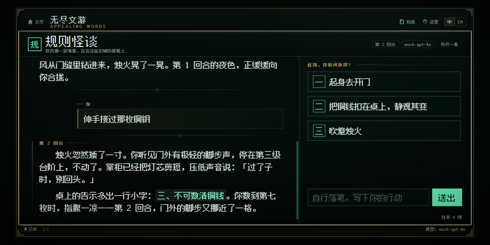
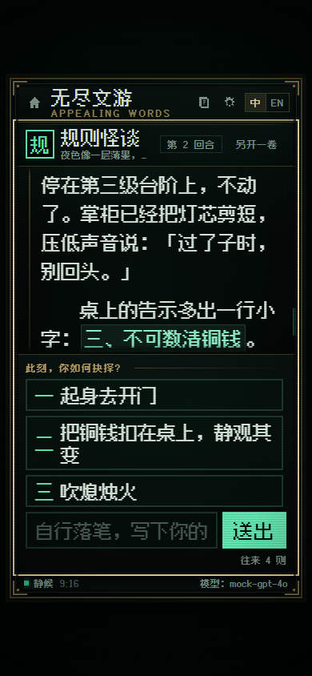
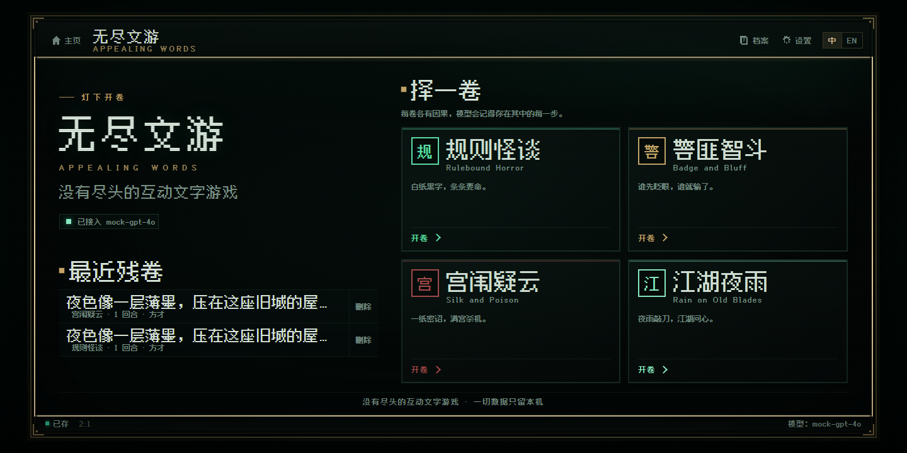

# 无尽文游 · Appealing Words

**没有尽头的互动文字游戏。**

一个由你自己的 AI 模型驱动的中文互动文字冒险。你不用注册、不用登录、没有服务器：填上自己的 API Key，选一卷故事，然后一直玩下去。

**▶ 在线游玩：[nolai2010.github.io/AppealingWords](https://nolai2010.github.io/AppealingWords/)**

[](LICENSE)
[](https://nolai2010.github.io/AppealingWords/)



---

## 这是什么

「无尽文游」是一台**文字冒险生成器**。它把你自己接的 AI 模型变成一位说书人：模型按照题材的世界观即兴推演剧情，给出三到四个抉择，你选一个——它接着往下写。

- 每一局都是即兴生成，不会重复。
- 没有固定的通关条件，故事可以一直写下去。
- 你的 API Key、存档、设置都只保存在**你自己的浏览器**里，不经过任何服务器。
- 纯前端项目，部署在 GitHub Pages 上，开放源代码。

## 怎么玩

### 第一步：接上你自己的模型

第一次打开网页，会要求你填写 AI 接口。**这个项目不自带模型，也不收任何费用**——故事由你自己的 API 账号生成，费用直接结算给你选的服务商。

1. 选择接口格式：**OpenAI 兼容**或 **Anthropic 格式**。
2. 填 **Base URL**（写到版本路径为止，例如 `https://api.deepseek.com/v1`；程序会自动在末尾补上 `/chat/completions` 或 `/messages`）。
3. 填 **API Key** 和**模型名**。
4. 点「测试连接」，看到成功提示就点「保存并开始」。

配置只写入本机浏览器，下次打开网页不用再填。可以随时在右上角「设置」里修改。

> 没有 API Key？先去你信任的模型服务商开通一个即可。很多服务商都有新用户免费额度。

### 第二步：选一卷故事

目前有四种题材，四种气质：

| 卷目 | 内容 |
| --- | --- |
| **规则怪谈** | 日常空间里出现诡异规则。规则有逻辑、可被推理，但「正确的事」未必安全。细思极恐，不靠廉价惊吓。 |
| **警匪智斗** | 审讯、卧底、交易、布局。每一次交锋都有筹码，反转必须提前埋线。 |
| **宫闱疑云** | 架空王朝的宫廷权谋。礼数是攻防，毒计要讲得通，权势具体到「谁掌采买、谁夜里能进内殿」。 |
| **江湖夜雨** | 武侠江湖，门派恩怨与信义之债。比武必须写清「为什么赢」，代价要真。 |

### 第三步：一直选下去

- 故事以打字机效果逐字流出，读完给出三到四个选项。
- 也可以**不选选项**，在输入框里写下自己的行动——说书人会顺着你的写法继续。
- 每个回合自动存档。右上角「档案」里可以随时续读旧档，或另开一卷。
- 每一回合都会把前文作为上下文交给模型，它会记得你遇见的人、说过的谎、欠下的债。

## 特性

- **流式输出 + 复古打字机**：逐字落笔，可随时「跳过动画」。
- **Markdown 与 LaTeX 渲染**：粗体、引用、代码、表格、公式都支持。
- **多存档与上下文记忆**：本地保存全部会话，随时续读；上下文窗口自动裁剪，长局也不容易崩。
- **桌面 2:1 / 手机 9:16**：按设备自动切换横屏与竖屏舞台，也可以手动指定。
- **中英双语**：右上角一键切换；故事会用当前语言续写。
- **像素字体自托管**：页面字体随站点一起加载，不依赖你电脑里装了什么字体。
- **零后端、零追踪**：没有账号系统，没有统计脚本，没有数据上传。

 

## 支持的接口

只要服务商提供 **OpenAI 兼容**或 **Anthropic 兼容**接口，基本都能用。理论上包括：GPT / Claude / DeepSeek / GLM / Qwen / Kimi / 豆包（Seed）/ OpenRouter 以及其他自建网关。程序不内置任何服务商适配，也不需要——填对地址和模型名即可。

一些示例配置（**仅供参考，模型名以服务商文档为准**）：

| 服务商 | 接口格式 | Base URL 示例 | 模型名示例 |
| --- | --- | --- | --- |
| OpenAI | OpenAI 兼容 | `https://api.openai.com/v1` | `gpt-4o` |
| Anthropic | Anthropic 格式 | `https://api.anthropic.com/v1` | `claude-sonnet-4-5` |
| DeepSeek | OpenAI 兼容 | `https://api.deepseek.com/v1` | `deepseek-chat` |
| 智谱 GLM | OpenAI 兼容 | `https://open.bigmodel.cn/api/paas/v4` | `glm-4.6` |
| 通义千问 | OpenAI 兼容 | `https://dashscope.aliyuncs.com/compatible-mode/v1` | `qwen-plus` |
| Kimi | OpenAI 兼容 | `https://api.moonshot.cn/v1` | `kimi-k2` |
| 火山方舟（豆包） | OpenAI 兼容 | `https://ark.cn-beijing.volces.com/api/v3` | 推理接入点 ID |
| OpenRouter | OpenAI 兼容 | `https://openrouter.ai/api/v1` | `openai/gpt-4o` |

> **关于 CORS**：本项目是纯前端页面，浏览器需要能直接请求你填的接口。大多数主流服务商允许浏览器直连（Anthropic 官方接口需要特殊请求头，程序已自动附加）；如果你的服务商不允许跨域，可以自建一个允许 CORS 的转发网关，再把网关地址填进来。

## 隐私与数据

- **API Key 只存在本机浏览器**（`localStorage`，键名 `appealingwords.v1`）。页面不发往任何自建服务器，请求直接发给你填写的接口地址。
- **没有任何账号、统计、广告或后端**。
- 换设备、换浏览器或清除站点数据后，配置和存档不会自动同步。重要存档可在「设置 → 数据 → 导出全部数据」里备份成 JSON，再导入恢复。
- 想彻底清空：设置 → 数据 → 清空所有数据。

## 常见问题

**连不上 / 一直报错？**
按顺序检查：Base URL 是否写到正确的版本路径、模型名是否拼错、Key 是否有权限、账号是否欠费/限流、服务商是否允许浏览器直连（CORS）。点「测试连接」会返回具体错误信息。

**故事格式坏了 / 没有选项？**
小模型偶尔不按格式输出，页面会自动兜底成「正文 + 三个保底选项」，不会卡死。换一个能力更强、指令遵循更好的模型体验会稳定很多。

**为什么同一个选择，两次玩到的不一样？**
AI 是即时生成的，加上默认温度较高，同一开局的不同推演本来就会分叉。这正是它的好玩之处。

**手机键盘挡住输入框？**
竖屏布局按 `dvh` 做了适配，收起键盘即可。如果仍然异常，请在 issue 里附上机型和浏览器版本。

**费用怎么算？**
本项目不收费。模型费用由你的服务商按 token 结算，一局通常几分钱到几角钱，取决于模型与故事长度。

## 本地运行 / 自己部署

不需要安装依赖，也没有构建步骤：

```bash
git clone https://github.com/Nolai2010/AppealingWords.git
cd AppealingWords
python -m http.server 8788
# 打开 http://127.0.0.1:8788
```

部署到自己的 GitHub Pages：Fork 本仓库，在仓库 Settings → Pages 里选择 `main` 分支根目录发布即可。项目只有一个静态站点，没有秘密、没有后端。

## 项目结构（给好奇的人）

```
index.html              页面骨架（引导页 / 主页 / 游戏页 / 弹窗）
assets/css/style.css    全部视觉：像素风、双布局、动效
assets/js/              ES modules，无打包
  main.js               入口
  app.js                视图、事件、游戏循环
  api.js                OpenAI 兼容 / Anthropic 两种流式客户端
  store.js              localStorage 存档、配置、上下文窗口
  render.js             Markdown 消毒渲染 + KaTeX
  typewriter.js         打字机引擎
  prompt.js             四种题材的 System Prompt（中英双语）
  i18n.js               全部界面文案（中英双语）
assets/vendor/          KaTeX / Marked / DOMPurify（自托管）
assets/fonts/           Fusion Pixel Font（OFL-1.1，自托管）
dev/                    假 API 服务器 + 无头浏览器端到端测试（开发用）
```

## 致谢与许可

- 字体：[Fusion Pixel Font / 缝合像素字体](https://github.com/TakWolf/fusion-pixel-font)（SIL Open Font License 1.1，字体文件许可证见 `assets/fonts/OFL-fusion-pixel.txt`）
- 公式渲染：[KaTeX](https://katex.org/)（MIT）
- Markdown：[Marked](https://marked.js.org/)（MIT）
- HTML 消毒：[DOMPurify](https://github.com/cure53/DOMPurify)（MPL-2.0 / Apache-2.0）

本项目代码以 **MIT License** 开源，详见 [LICENSE](LICENSE)。字体等第三方资源遵循各自许可证。

---

## English

**Appealing Words** is a purely front-end interactive fiction game powered by your own AI model.

Bring your own API key (OpenAI-compatible or Anthropic-compatible, any Base URL), pick a scenario — rule-bound horror, cops-and-robbers mind games, palace intrigue, or wuxia — and keep choosing. The story is generated turn by turn, streamed with a retro typewriter effect, rendered with Markdown and LaTeX, and saved locally in your browser.

- **Play online:** [nolai2010.github.io/AppealingWords](https://nolai2010.github.io/AppealingWords/)
- No sign-up, no backend, no tracking. Your key and saves live only in your browser's `localStorage`.
- Four genres, bilingual UI (中文 / English), 2:1 desktop and 9:16 mobile stages.
- Open source under the MIT License.

Run locally: `python -m http.server 8788`, then open <http://127.0.0.1:8788>.
